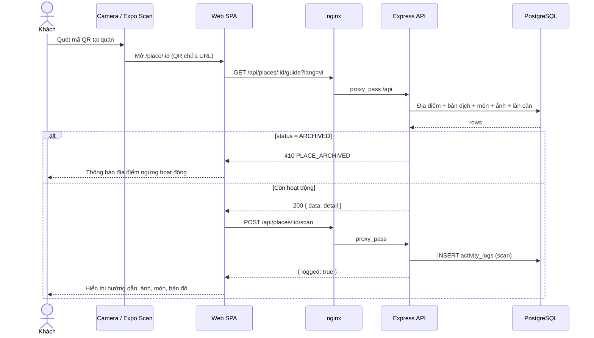
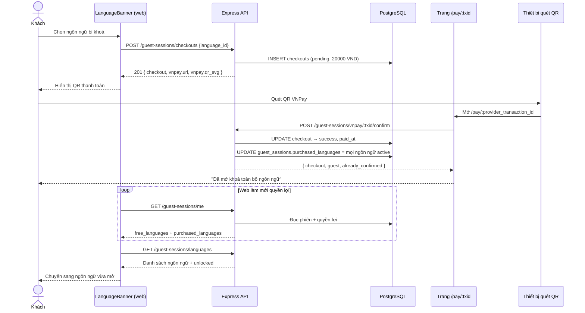
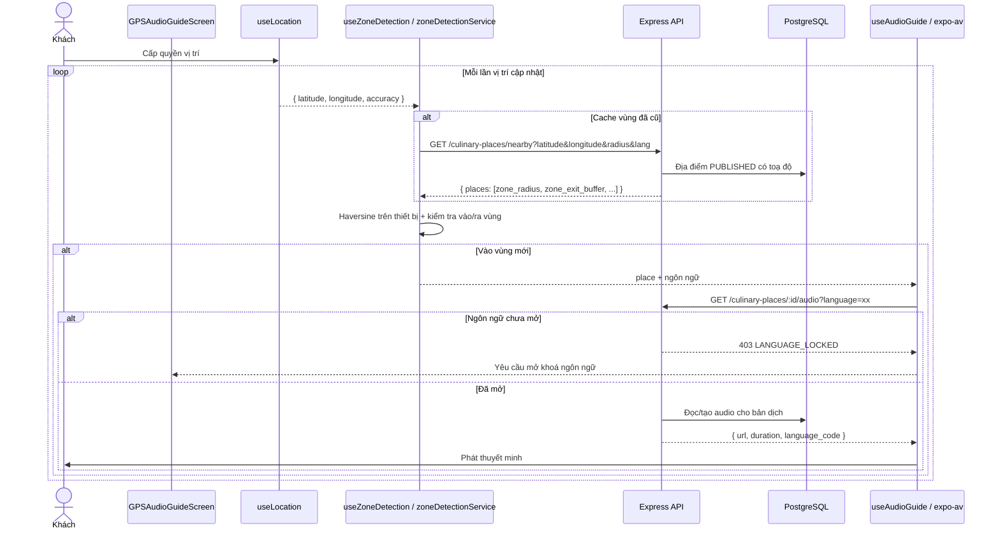
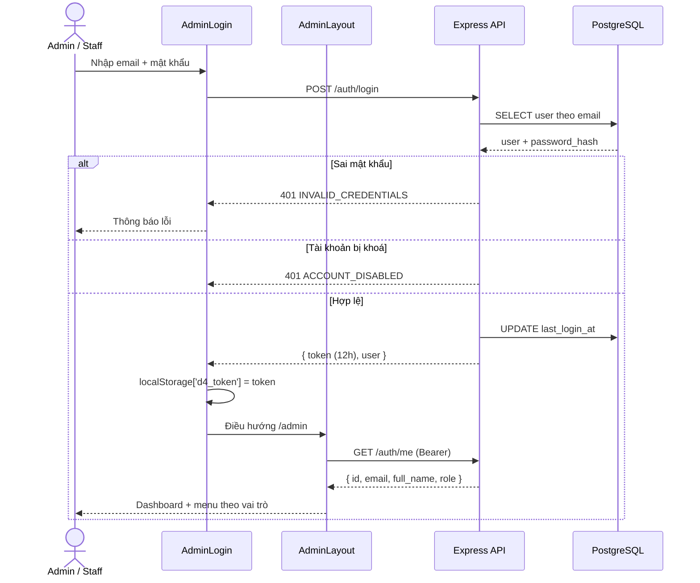

# Biểu đồ tuần tự — District 4 Culinary Guide

> Nguồn: `routes/guest.js`, `middleware/entitlement.js`, `services/entitlementService.js`,
> `services/placeService.js`, `services/mediaService.js`, `services/geoAudioService.js`,
> `apps/web/src/**`, `apps/mobile/src/**`.
> Biểu đồ phản ánh luồng thực tế trong code; các điểm sai lệch được ghi chú ngay dưới.

## 1. Quét QR mở hướng dẫn địa điểm (UC-01 → UC-02)

Ghi chú: ứng dụng mobile viết lại host `localhost` trong QR thành IP LAN trước khi mở
(`ScanScreen.js`) để điện thoại mở được website trên máy tính.

## 2. Paywall ngôn ngữ và thanh toán VNPay-QR (UC-03 → UC-04)

Ghi chú:

- Đây là **sandbox**: không có lời gọi ra VNPay; mở trang `/pay/:txid` chính là xác nhận.
- Thiết bị quét không cần phiên khách; endpoint `vnpay/.../confirm` là công khai.
- Xác nhận lặp idempotent nhờ `already_confirmed` và partial unique
  `uq_checkouts_success_pair`.
- Luồng thay thế khi xác nhận trên chính thiết bị:
  `POST /guest-sessions/checkouts/:id/confirm` dùng cùng logic.

## 3. Thuyết minh tự động theo vùng GPS (UC-10)

Ghi chú:

- Ngưỡng vào là `distance <= zone_radius`; chỉ rời khi
  `distance > zone_radius + zone_exit_buffer` (hysteresis chống rung GPS).
- Nếu đang phát clip khác, clip mới được xếp hàng và phát khi clip hiện tại kết thúc
  (`useAudioGuide.js:139-150`).
- Audio có thể được sinh TTS ở lần gọi đầu; các lần sau trả file đã lưu.

## 4. Đăng nhập quản trị (UC-12)

Ghi chú:

- Token hết hạn sau 12 giờ; không có refresh token hay thu hồi phía server.
- `AdminLayout` gọi `/auth/me` mỗi lần vào CMS để xác thực token còn hiệu lực.
- Menu Người dùng & Vai trò chỉ hiển thị với `role = 'ADMIN'`.
